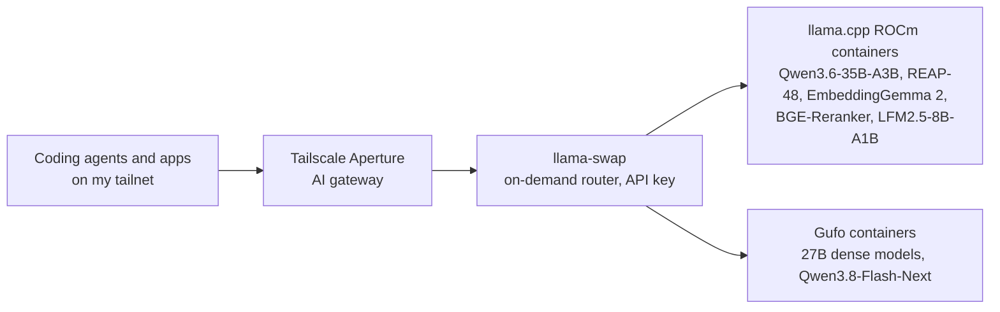

# Local AI on a Framework Desktop (AMD Strix Halo + CachyOS)

How I run a multi-model local AI stack on a Framework Desktop with the AMD Ryzen AI Max+ 395 ("Strix Halo") and 128 GB of unified memory: the models, the router, the kernel and engine settings that matter, and what each model actually does on this hardware.

Full numbers and methodology: **[BENCHMARKS.md](BENCHMARKS.md)**.

*Last updated: 2026-10-10.*

---

## Hardware

| Part | Spec |
|---|---|
| Machine | Framework Desktop |
| APU | AMD Ryzen AI Max+ 395 (16 Zen 5 cores) |
| GPU | Radeon 8060S, 40 CU RDNA 3.5 (`gfx1151`) |
| Memory | 128 GB unified LPDDR5X, ~256 GB/s shared by CPU and GPU |
| OS | CachyOS Linux |
| GPU runtime | ROCm 10.0 in containers |

## How it fits together



- **[llama-swap](https://github.com/mostlygeek/llama-swap)** starts a model's container on the first request and stops it after 5 idle minutes. A residency matrix decides which models may be loaded together.
- Every model server listens on localhost only. The only way in is through llama-swap, which requires an API key.
- llama.cpp runs in the [AMD Strix Halo Toolboxes](https://github.com/kyuz0/amd-strix-halo-toolboxes) ROCm images. The 27B dense models and Flash-Next run on [Gufo](https://github.com/gufo-org/gufo), which was faster on this chip in my tests (see [BENCHMARKS.md §3](BENCHMARKS.md#3-engine-showdown-27b-dense-and-flash-next-2026-09-28)).

## Model lineup

| Model | Quant | Engine | Slots × context | Decode (single stream) | Used for |
|---|---|---|---|---|---|
| **Qwen3.6-35B-A3B** (MoE) | UD-Q8_K_XL | llama.cpp, MTP + n-gram drafts | 2 × 262K | 56.8 tok/s avg, up to 195 on refactors | Daily coding, vision/OCR |
| **Qwen3.6-35B-A3B REAP-48** (expert-pruned MoE) | iq3_s / q6_K | llama.cpp | 8 × 128K | 53.2 tok/s, 147 tok/s across 8 streams | Parallel subagents |
| **Swift-Qwen3.8-27B** (dense) | Q6_K | Gufo, DFlash2 drafter | 1 × 262K | 26.6 avg / 37.3 peak | Deep reasoning |
| **OrcaSAQ-2 27B** (abliterated Qwen3.8-27B) | mixed imatrix | Gufo, DFlash2 drafter | 1 × 262K | 35.3 avg / 49.3 peak | Reasoning, smaller and faster weights |
| **Qwen3.8-27B Uncensored** (abliterated) | Q6_K | Gufo, DFlash2 drafter | 1 × 262K | 28.0 avg / 43.6 peak | Unfiltered reasoning |
| **Qwen3.8-Flash-Next** (~130B, linear attention) | UD-Q4_K_XL | Gufo, MTP drafter | 1 × 128K | 43.5 avg / 57.5 peak | Long-context work, fastest end-to-end |
| **EmbeddingGemma 2** | Q8_0 | llama.cpp | 8 × 8K | 367 chunks/s | RAG and code search |
| **BGE-Reranker-v2-M3** | Q8_0 | llama.cpp | 4 slots | 250 pairs/s | Search reranking |
| **LFM2.5-8B-A1B** (MoE, ~1B active) | Q6_K | llama.cpp | 2 × 32K | ~120 tok/s | Agent memory extraction, session titles |

**What can be loaded at once:** Qwen3.6-35B-A3B and the 27B dense models exclude each other. REAP-48 fits next to either. Flash-Next (~104 GiB of weights) runs alone. The embedding, reranker and LFM2.5 models are small enough to sit next to anything.

## Settings that matter on Strix Halo

### Kernel parameters

```text
amdgpu.gttsize=131072
ttm.pages_limit=33554432
amd_iommu=off
```

These let the GPU address almost all of the 128 GB as GTT memory, which is what makes a 104 GiB model loadable at all.

### ROCm environment variables

Two variables from older Strix Halo guides, A/B tested on ROCm 10 with llama.cpp in October 2026 ([BENCHMARKS.md §13](BENCHMARKS.md#13-rocm-environment-variables-2026-10-10)):

| Variable | Prefill (2K–8K) | Decode | Model load | Verdict |
|---|---|---|---|---|
| `ROCBLAS_USE_HIPBLASLT=1` | **+3–5%** | no change | no change | Keep |
| `HSA_ENABLE_SDMA=0` | no change | no change | **~0.4 s slower** (+13%) | Not needed for speed |

`HSA_ENABLE_SDMA=0` was originally a workaround for SDMA hangs on older kernel/ROCm combinations. A 10-minute benchmark can't show whether that's still needed, and [one evidence-tracking guide](https://github.com/hogeheer499-commits/strix-halo-guide) no longer recommends it by default. The Gufo containers run without either variable.

### llama.cpp flags

| Flag | Why |
|---|---|
| `-t 8 -tb 16` | 8 threads for generation (same speed as 16, half the CPU power), all 16 for prompt processing |
| `-b 4096 -ub 1024` | +22% MoE prefill over smaller micro-batches; `-ub 4096` was slower at long context |
| `--spec-type draft-mtp,ngram-mod` | MTP covers fresh text, n-gram covers copy-heavy edits; +50% on file edits, no extra memory |
| `--spec-draft-n-max 4 --spec-draft-p-min 0.75` | Best draft depth for Qwen3.6-35B-A3B (n=5 truncated multi-line edits) |
| `--cache-type-k q8_0 --cache-type-v q8_0` | Half the KV memory, so 262K per slot fits |
| `--cache-ram 8192` | Host-RAM prefix cache: follow-up turns prefill ~10× faster |
| `--prio 2` | Steadier timings under desktop load |

**Gotcha:** `--ctx-size` is the total across all slots, not per slot. `-np 8 --ctx-size 8192` gives each request 1,024 tokens. Check `n_ctx_slot` in the startup log.

## Headline results

- **Speculative decoding is the biggest lever.** Qwen3.6-35B-A3B refactors at 195.6 tok/s with 99.8% of drafts accepted. On a 27B dense model, adding n-gram drafts on top of MTP raised file-edit speed by 139%.
- **Gufo beat llama.cpp for 27B dense and Flash-Next.** With the same DFlash2 drafter, it was 19% faster and used 6 GB less memory, and it loads in 3.5–14 s.
- **Expert pruning beat low-bit quantization.** The REAP-pruned 35B (8.78 GiB) matched the full model on a 15-problem HumanEval set (13/15). A uniform 2-bit quant of similar size got 11/15 and had 7× slower prefill.
- **8 agents × 90K context on one box.** The REAP-pruned 35B held 722K tokens in flight and found 8/8 needles while using 24.6 GB of memory at 29–38 W.
- **Linear attention scales prefill.** Qwen3.8-Flash-Next reads a 32K prompt at 1,663 tok/s, about 3× the 27B dense models.

## Other services

- **Search:** self-hosted [SearXNG](https://github.com/searxng/searxng) with a Redis cache, used as the agents' only web search.
- **Voice:** [Speaches](https://github.com/speaches-ai/speaches) (Kokoro TTS + Faster-Whisper STT) on CPU.
- **Agents:** [Oh My Pi](https://github.com/can1357/oh-my-pi) as the terminal coding agent, with subagents running in Btrfs reflink worktrees.

## Recent changes

**2026-10-07**
- Added JSON-mode variants of the Qwen3.6 models. With `--reasoning-format none`, llama-server rejects every `json_schema` request with `400 Failed to initialize samplers`. llama-swap's `filters.setParamsByID` now exposes a second model name on the same process, injecting `reasoning_format: auto` per request. No extra memory.
- Added LFM2.5-8B-A1B for agent memory extraction. It scored 8/8 on my extraction test set, against 6/8 for LFM2.5-2.6B and 3/8 for the 230M model it replaced.
- Embeddings moved from BGE-M3 to EmbeddingGemma 2: 1.5× the throughput, 1.6× lower latency, 25% smaller vectors. This needed a newer dated toolbox image for the `gemma-embedding2` architecture.

**2026-10-05**
- SearXNG: turned off engines that returned off-topic results. Coding queries went from 8/12 on topic to 12/12.

**2026-10-03**
- Added OrcaSAQ-2 27B. On the same weights and drafter, Gufo was 19% faster than llama.cpp.

**2026-09-28**
- Compared engines for the 27B and Flash-Next tiers. Gufo won both. Retired the Halogen and llama.cpp variants.

**2026-09-14**
- Crucible MoE compression sweep. The REAP-pruned 35B became the subagent model.

## Upstream projects

- [llama.cpp](https://github.com/ggerganov/llama.cpp) for inference
- [Gufo](https://github.com/gufo-org/gufo), a Strix Halo inference engine (27B dense with DFlash2, Flash-Next with MTP)
- [Halogen](https://github.com/peonist-ai/halogen-server) and [Halogen Flash](https://github.com/peonist-ai/halogen-flash-server), Strix Halo engines for Qwen3.8 27B and Flash-Next (compared in [BENCHMARKS.md](BENCHMARKS.md))
- [llama-swap](https://github.com/mostlygeek/llama-swap) for model routing and lifecycle
- [AMD Strix Halo Toolboxes](https://github.com/kyuz0/amd-strix-halo-toolboxes) for the ROCm container images
- [Crucible](https://github.com/peonist-ai/crucible) for MoE expert profiling and REAP pruning
- [EleutherAI lm-evaluation-harness](https://github.com/EleutherAI/lm-evaluation-harness) and [EvalPlus](https://github.com/evalplus/evalplus) for quality evals
- [Tailscale Aperture](https://github.com/tailscale/aperture-cli) as the AI gateway

---

This repo is a write-up. My configs and tooling are kept privately.
